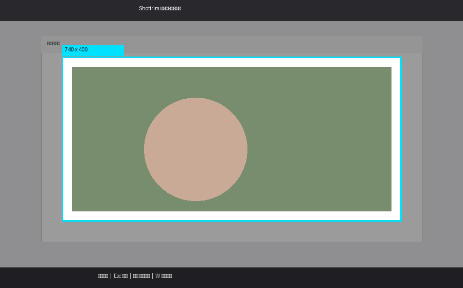

# Shottrim — 精准边缘截图工具

> 按 **Alt+Q**，自动吸附窗口、识别图像边缘，只截取图片本身，去掉窗口背景，结果直接进剪贴板。



## 功能特性

| 特性 | 说明 |
|------|------|
| **全局快捷键** | `Alt+Q` 召唤（被占用时自动切换 `Ctrl+Alt+Q`） |
| **窗口自动吸附** | 全屏蒙层出现前枚举所有窗口，鼠标移动实时高亮鼠标下最小的窗口，单击确认 |
| **边缘识别** | 行/列方差法检测内容边界，不依赖背景色具体值，照片内有白色衣物也不误判 |
| **透明背景** | 可选把窗口背景变成透明（PNG alpha 通道），只保留图像本身 |
| **剪贴板输出** | 结果直接写入剪贴板（CF_DIB + BITMAPV4HEADER，保留 alpha），Ctrl+V 即可粘贴 |
| **开机自启** | 注册表 `HKCU\...\Run` 项，开机自动后台驻留 |

## 使用方法

### 1. 安装依赖

```bash
pip install mss pillow numpy scipy pywin32
```

### 2. 运行

```bash
# 前台运行（调试用）
python shottrim.py

# 后台驻留（推荐）
python shottrim.py --daemon

# 注册开机自启并立即启动
python shottrim.py --install-autostart

# 取消开机自启
python shottrim.py --uninstall-autostart
```

### 3. 截图流程

1. 切到要截图的窗口（浏览器、图片查看器等）
2. 按 **Alt+Q** → 全屏出现半透明蒙层 + 十字准星
3. 移动鼠标到目标窗口 → 蓝色框自动贴住该窗口，显示尺寸
4. 按 **↑ / ↓** 向内收缩（去掉窗口边框/工具栏），或按 **W** 重新吸附
5. **单击** 确认 → 自动识别图像边缘 → 结果写入剪贴板
6. 到目标窗口 **Ctrl+V** 粘贴即可

### 4. 命令行参数

| 参数 | 默认值 | 说明 |
|------|--------|------|
| `--hotkey` | `alt+q` | 全局快捷键组合 |
| `--threshold` | `30` | 背景色判定容差（越大越激进） |
| `--margin` | `0` | 内容四周额外边距（像素） |
| `--transparent` | 开启 | 背景做成透明 PNG |
| `--no-transparent` | — | 关闭透明，保留原背景色 |
| `--clipboard` | 开启 | 结果复制到剪贴板 |
| `--no-clipboard` | — | 不复制剪贴板 |
| `--auto` | — | 自动截取整个前台窗口（跳过交互） |
| `--rect X Y W H` | — | 直接指定区域，跳过交互 |
| `--delay N` | `0` | 弹出选区前等待 N 秒 |
| `--daemon` | — | 后台驻留，全局快捷键召唤 |
| `--install-autostart` | — | 注册开机自启并立即启动 |
| `--uninstall-autostart` | — | 移除开机自启 |

## 技术要点

- **窗口枚举**：`EnumWindows` + `DWMWA_EXTENDED_FRAME_BOUNDS`，排除工具窗口/桌面
- **窗口吸附**：蒙层创建前枚举缓存 1 秒，鼠标移动时找包含鼠标的最小窗口
- **边缘检测**：行/列颜色方差（`np.var`），找最长连续内容段，排除工具栏碎片
- **剪贴板**：`BITMAPV4HEADER` + `BI_BITFIELDS` 四掩码，保留 alpha 通道
- **后台驻留**：`RegisterHotKey` + `GetMessageW` 消息循环，`pythonw.exe` 无控制台运行

## 文件说明

| 文件 | 说明 |
|------|------|
| `shottrim.py` | 主程序（约 750 行） |
| `shottrim_daemon.vbs` | 开机自启脚本（无窗口启动 pythonw） |
| `.gitignore` | 忽略 `__pycache__`、`.log` 等 |

## 已知限制

- 响应速度比微信截图略慢（tkinter 蒙层启动开销）
- 复杂背景下边缘识别可能不准（可通过 `--threshold` 调整）
- 仅支持 Windows（依赖 Win32 API）

## 许可证

MIT
